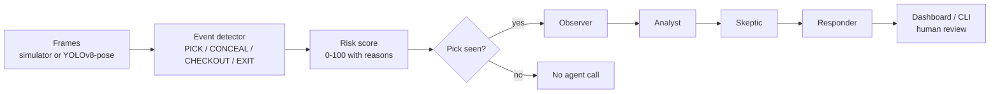

# Pick & Track Agents

> An explainable shoplifting / pick-up detection demo with a **multi-agent AI review layer** on top of the vision events.
> Inspired by my *Pick & Track* thesis.


-e8832a)

<!-- Add a screenshot of the dashboard here:  -->

## Overview

Pick & Track Agents turns people tracks and wrist keypoints into store events (`PICK`, `CONCEAL`, `CHECKOUT`, `EXIT`), scores the risk with a transparent formula, and hands suspicious cases to a small team of agents that review them like a human loss-prevention team would. It never accuses anyone: every alert ends in **human review**.

It runs fully offline with a built-in store simulator and rules-only agents. Add an API key and the same agents use an LLM.



## Features

- **Explainable vision rules** on bounding boxes and wrist keypoints, with configurable zones.
- **Transparent risk score** (0-100). Every point is traced to a reason.
- **Four cooperating agents** that run only for people who picked something, which keeps LLM cost low.
- **Provider-agnostic LLM client** (Groq or Anthropic) with an automatic rules-only fallback.
- **Guardrails** and a deterministic final decision (see below).
- **Live dashboard** (FastAPI + vanilla JS) and a CLI.
- **Dockerized** and covered by 7 automated tests.

## How it works

### 1. Detector

| Event | Rule |
|---|---|
| `PICK` | A wrist stays inside a shelf zone for at least 0.4 s, then leaves it |
| `CONCEAL` | Within 6 s after a pick, a wrist stays in the torso/pocket area for at least 0.5 s |
| `CHECKOUT` | The person's feet stay in the checkout zone for at least 1 s |
| `EXIT` | The person's feet enter the exit zone |

A quick 0.2 s touch of a shelf is deliberately **not** a pick.

### 2. Risk score

Picks and concealment gestures add points, leaving with items and no checkout adds more, and time at the checkout reduces the score. Levels: `LOW` below 25, `MEDIUM` below 55, `HIGH` from 55.

### 3. Agents

| Agent | Role |
|---|---|
| **Observer** | Writes a neutral, factual timeline from the events |
| **Analyst** | Gives a verdict: `normal`, `suspicious` or `likely_theft` |
| **Skeptic** | Argues the innocent explanations to fight false positives |
| **Responder** | Chooses `log_only`, `notify_staff_assist` or `escalate_to_security_review` |

### 4. Guardrails

- The LLM can move the Analyst verdict **at most one step** away from the rules-based baseline.
- Empty or malformed LLM output falls back to rules.
- The Responder's **decision is deterministic**. The LLM only writes the wording.
- Every non-trivial action sets `requires_human_review`.

## Quick start

```bash
git clone https://github.com/mohamedmouzaoui/pick-and-track-agents.git
cd pick-and-track-agents

python -m venv .venv && source .venv/bin/activate
pip install -r requirements-dev.txt

python run_demo.py --scenario mixed        # CLI, fully offline
uvicorn picktrack.api:app --reload         # dashboard on http://127.0.0.1:8000
pytest                                     # run the tests
```

With Docker:

```bash
docker compose up --build                  # dashboard on http://localhost:8000
```

### Scenarios

| Scenario | What happens |
|---|---|
| `honest` | Picks one item, pays at the checkout, leaves |
| `shoplifter` | Picks two items, conceals both, leaves without paying |
| `browser` | Touches a shelf briefly, picks nothing, leaves |
| `mixed` | All three at once, with separate tracks |

### Example output

```
[   3.2s] #1 PICK     shelf_A {'reach_s': 1.2}
[   6.2s] #1 CHECKOUT checkout
[   9.7s] #2 PICK     shelf_B {'reach_s': 1.0}
[  10.2s] #2 CONCEAL  shelf_B
...
CASE 2 | person #2 | HIGH 62/100 | trigger: risk_high
  Analyst  : likely_theft (0.62)
  Skeptic  : doubt=0.2
  Responder: escalate_to_security_review (human review: True)
```

## Configuration

### LLM agents (optional)

```bash
cp .env.example .env
```

| Variable | Purpose |
|---|---|
| `GROQ_API_KEY` | Use Groq (`llama-3.3-70b-versatile` by default) |
| `ANTHROPIC_API_KEY` | Use Anthropic (`claude-sonnet-4-6` by default) |
| `LLM_PROVIDER` | Force `groq`, `anthropic` or `offline` |
| `GROQ_MODEL`, `ANTHROPIC_MODEL` | Override the default models |

Leave everything empty to run rules-only. The dashboard tags each agent message as `llm` or `rules`, so you can always see what is real AI.

### Zones

Edit `config/zones.json`. Rectangles are in pixels of a reference frame size and are rescaled automatically to your video.

### Real video

```bash
pip install ultralytics
python run_demo.py --video store.mp4
```

`YoloSource` uses YOLOv8-pose with ByteTrack. It follows the Ultralytics API but has not been run on real footage yet, so expect to tune zones and thresholds.

## API

| Method | Endpoint | Description |
|---|---|---|
| `GET` | `/` | Dashboard |
| `GET` | `/api/health` | Status, active LLM provider, scenarios |
| `POST` | `/api/run?scenario=mixed&speed=8` | Start a simulated run |
| `GET` | `/api/state` | Live events, risks, persons and agent cases |
| `POST` | `/api/reset` | Clear state |

## Project layout

```
picktrack/
  models.py      data classes            agents.py     4 agents + orchestrator
  zones.py       zone rectangles         llm.py        Groq / Anthropic / offline client
  detector.py    event rules             pipeline.py   glue + live triggers
  risk.py        risk score              api.py        FastAPI + static dashboard
  sources.py     simulator + YOLO source
config/zones.json
tests/test_pipeline.py
run_demo.py
```

## Limitations

- The simulator stands in for real video. The detector is rule-based and sees **hand gestures, not actual products**.
- Hand-near-torso is a weak signal on its own (phones, wallets, personal bags), which is why the Skeptic agent exists.
- A real deployment would need object-level detection and extensive false-positive testing.
- Analyzing people with cameras carries legal and privacy requirements (signage, retention limits, GDPR-style rules). This is a learning and portfolio project, not a production loss-prevention system.

## Roadmap

- [ ] Evaluate on a public or self-recorded video set
- [ ] Object-level detection to confirm that an item was actually taken
- [ ] Re-open a case when new events arrive after the first alert
- [ ] Export cases as JSON / CSV

## Author

**Mohamed Mouzaoui** - cybersecurity graduate and full-stack developer, 
[GitHub](https://github.com/mohamedmouzaoui) · [LinkedIn](https://linkedin.com/in/mohamed-mouzaoui-19ab8740a)
